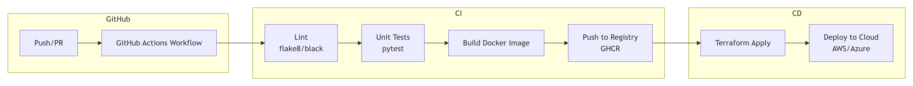
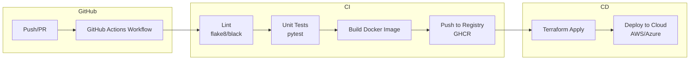

# CI/CD Template for AI Projects

A reusable GitHub Actions pipeline that automates linting, testing, Docker image building, and deployment for AI/ML projects.

## Table of Contents
- [Overview](#overview)
- [Architecture](#architecture)
- [Features](#features)
- [Tech Stack](#tech-stack)
- [Prerequisites](#prerequisites)
- [Setup](#setup)
- [GitHub Actions Workflow](#github-actions-workflow)
- [Docker Integration](#docker-integration)
- [Terraform Deployment](#terraform-deployment)
- [Adapting to Your Project](#adapting-to-your-project)
- [Troubleshooting](#troubleshooting)

---

## Overview

This template provides a robust CI/CD pipeline that you can add to any AI project repository. It ensures code quality, runs tests, builds a Docker image, and optionally deploys to a cloud provider using infrastructure as code.

**Key aspects**:
- **Automated Linting**: flake8 and black.
- **Unit Testing**: pytest.
- **Containerization**: Docker image built and pushed to GitHub Container Registry (GHCR).
- **Infrastructure as Code**: Terraform modules for AWS (or Azure).
- **Deployment**: Script to deploy the container to a cloud service (ECS, AKS, etc.).

---

## Architecture





---

## Features

- **Linting**: Checks code style with flake8 and black.
- **Testing**: Runs pytest tests.
- **Docker**: Builds a Docker image and pushes it to GitHub Container Registry.
- **Secrets**: Uses GitHub secrets for Docker credentials and cloud API keys.
- **Deployment**: Optional Terraform step to deploy the container to AWS ECS or Azure AKS.

---

## Tech Stack

| Component          | Technology                    |
|--------------------|-------------------------------|
| **CI/CD**          | GitHub Actions                |
| **Linting**        | flake8, black                 |
| **Testing**        | pytest                        |
| **Container**      | Docker, GHCR                  |
| **Infrastructure** | Terraform                     |
| **Cloud**          | AWS (example)                 |

---

## Prerequisites

- GitHub repository with this template.
- Docker Hub or GitHub Container Registry (GHCR) access.
- (Optional) Cloud account (AWS, Azure) for deployment.

---

## Setup

### 1. Clone the Repository
```bash
git clone https://github.com/your-username/ai-ci-cd-template.git
cd ai-ci-cd-template
```

### 2. Create Virtual Environment & Install Dependencies
```bash
python -m venv venv
source venv/bin/activate
pip install -r requirements.txt
```

### 3. Set Up GitHub Secrets
Go to your repository → Settings → Secrets and variables → Actions → New repository secret.

Add:
- `DOCKER_USERNAME` – GitHub username or Docker Hub username
- `DOCKER_PASSWORD` – GitHub personal access token (with `write:packages`) or Docker Hub token
- (If using AWS) `AWS_ACCESS_KEY_ID` and `AWS_SECRET_ACCESS_KEY`

### 4. Customize the Workflow
Edit `.github/workflows/ci.yml` to match your project's test directory, Docker image name, and deployment preferences.

---

## GitHub Actions Workflow

The workflow is triggered on `push` to `main` and on pull requests.

**Steps**:
1. **Checkout code**
2. **Set up Python**
3. **Install dependencies**
4. **Lint** (flake8, black)
5. **Test** (pytest)
6. **Build Docker image**
7. **Push to GHCR** (if on main branch)
8. **Deploy** (if on main and `deploy` is true)

---

## Docker Integration

The `Dockerfile` builds a container for the FastAPI example app. You can replace the contents of `src/` with your own application code. The Dockerfile:

- Uses `python:3.10-slim`
- Installs requirements
- Copies the source code
- Exposes port 8000
- Runs the app with `uvicorn`

---

## Terraform Deployment

The `terraform/` folder contains example Terraform code to deploy the Docker container to AWS ECS. To use:

1. Initialize Terraform: `terraform init`
2. Plan: `terraform plan`
3. Apply: `terraform apply`

The workflow can run these commands automatically if you enable the deployment step.

---

## Adapting to Your Project

1. **Replace the sample app** with your own `src/` and `tests/`.
2. **Update `requirements.txt`** to match your dependencies.
3. **Adjust the GitHub Actions workflow**:
   - Change the `test_dir` if your tests are elsewhere.
   - Modify the Docker image name.
   - Toggle deployment steps as needed.
4. **Add cloud credentials** as GitHub secrets.

---

## Troubleshooting

| Problem | Solution |
|---------|----------|
| Lint fails | Run `black .` and `flake8` locally to fix issues. |
| Tests fail | Ensure your tests pass locally before pushing. |
| Docker build fails | Check the Dockerfile and that all files are copied correctly. |
| GHCR push fails | Verify the token has `write:packages` scope. |
| Terraform apply fails | Check AWS credentials and IAM permissions. |

---

## License

MIT